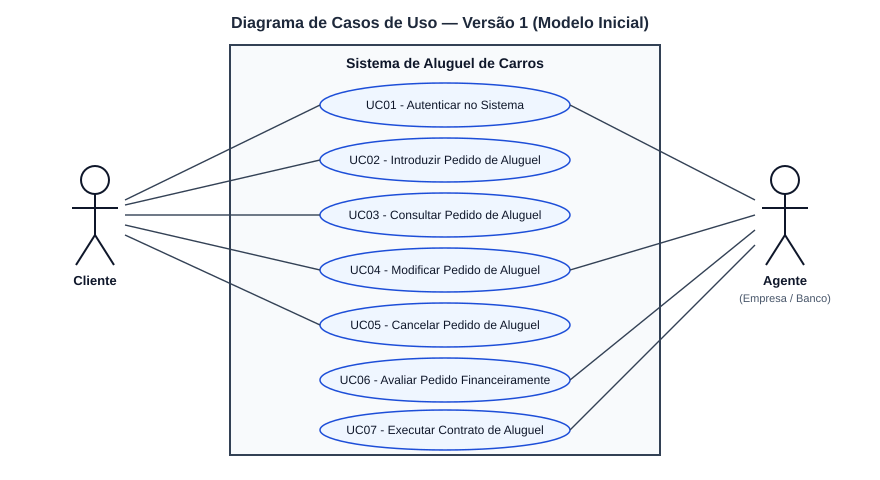
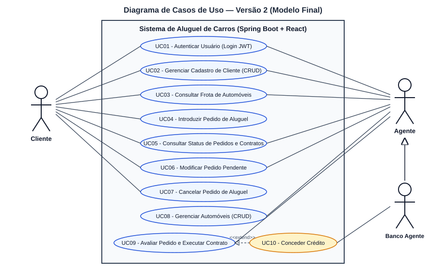
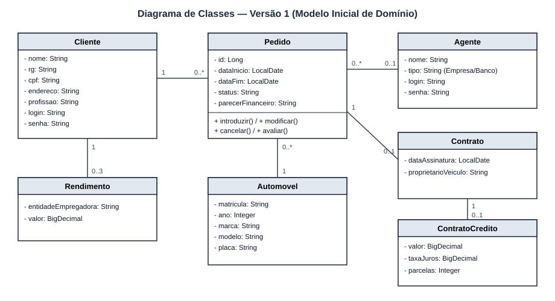
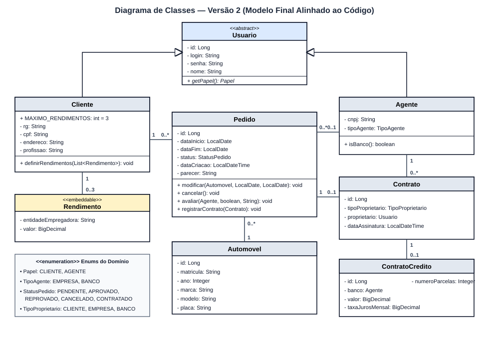
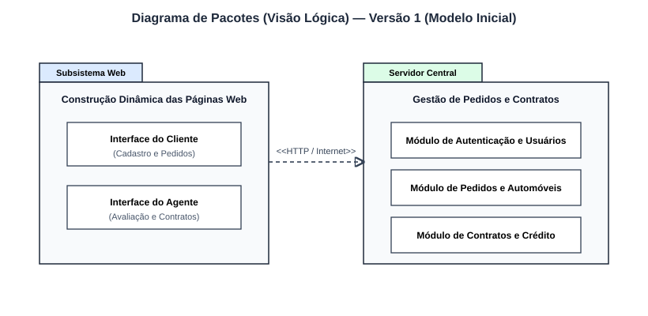
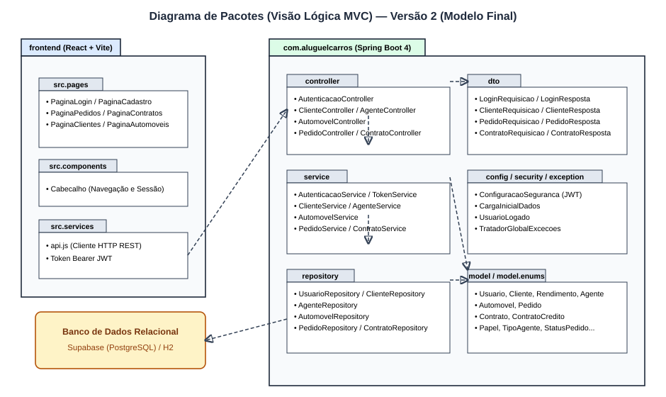

# Evolução da Modelagem UML (Versão 1 → Versão 2)

Este documento registra a comparação entre os modelos conceituais iniciais (**v1**) e os modelos finais alinhados ao código-fonte implementado (**v2**).

---

## 1. Diagrama de Casos de Uso

| Versão 1 (Inicial) | Versão 2 (Final) |
| :---: | :---: |
|  |  |

### Modificações realizadas na v2:
- Inclusão dos casos de uso explícitos de **CRUD de Cliente** (`UC02`) e **CRUD de Automóveis** (`UC08`).
- Especialização do ator **Banco Agente** a partir de **Agente**, associando-o à concessão de crédito (`<<extend>>` sobre a execução do contrato).

---

## 2. Diagrama de Classes

| Versão 1 (Inicial) | Versão 2 (Final) |
| :---: | :---: |
|  |  |

### Modificações realizadas na v2:
- Criação da superclasse abstrata `Usuario` (`@Inheritance(strategy = InheritanceType.JOINED)`), centralizando `id`, `login`, `senha` e `nome` para `Cliente` e `Agente`.
- Modelagem de `Rendimento` como `@Embeddable` dentro de uma `@ElementCollection` em `Cliente`, validando o limite `MAXIMO_RENDIMENTOS = 3`.
- Introdução das enumerações `Papel`, `TipoAgente`, `StatusPedido` e `TipoProprietario` para garantir tipagem forte nas transições de estado do pedido e na definição de propriedade do veículo.

---

## 3. Diagrama de Pacotes (Visão Lógica)

| Versão 1 (Inicial) | Versão 2 (Final) |
| :---: | :---: |
|  |  |

### Modificações realizadas na v2:
- Detalhamento do subsistema Web (`frontend`) nos pacotes `src.pages`, `src.components` e `src.services`.
- Detalhamento do subsistema de Gestão de Pedidos e Contratos (`backend`) seguindo a arquitetura MVC do Spring Boot nos pacotes `controller`, `dto`, `service`, `repository`, `model`, `config`, `security` e `exception`.
